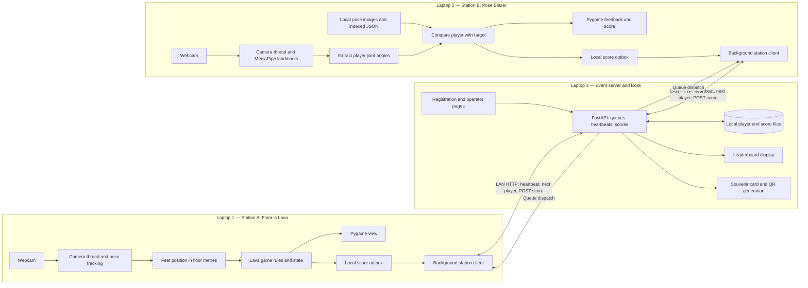
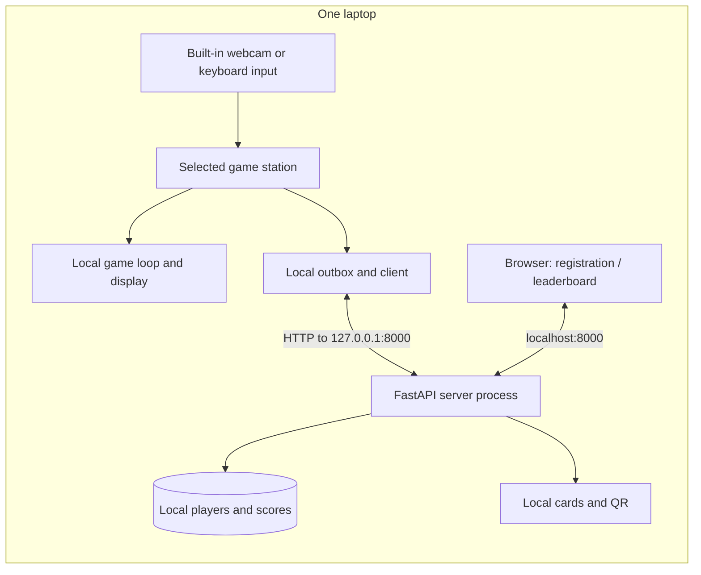

# Titans' Arcade — architecture and contribution overview

This is a body-controlled arcade system with two games that can run as separate
stations. Each station handles its own camera and game loop. A local FastAPI
server can register players, dispatch queues, collect scores, and show a shared
leaderboard and souvenir cards.

## Three-laptop event setup

All three laptops connect to the same local Wi-Fi/LAN. The game stations do
camera inference and gameplay locally; the network carries player/score data.



### What happens during a game

1. **Register and queue.** An operator registers a player on Laptop 3 and can
   choose Station A or B. The server keeps player records and a station queue.
   The idle station polls in the background and receives the next player.
2. **Track the player locally.** A station's camera worker captures frames and
   runs MediaPipe. The game loop reads the latest pose sample without waiting
   for camera inference. Station A maps the player's feet from image pixels to
   floor metres using a calibrated homography. Station B extracts joint angles
   and compares them to an already-indexed target pose.
3. **Run game rules and render.** Pure game logic updates game state; Pygame
   renders that state and the tracking/match feedback. Camera work and network
   calls are kept off the main game loop.
4. **Save the score before sending it.** At game end, the station appends a
   `ScoreEvent` to its local `outbox.jsonl`. A background client retries delivery
   to Laptop 3. This lets a station continue if the server or LAN is temporarily
   unavailable.
5. **Show the event result.** The server accepts scores idempotently using the
   event ID, stores them locally, refreshes the leaderboard, and generates a
   souvenir card/QR for the player. The server also attempts public card
   hosting by default; it can be disabled with `DISABLE_PUBLIC_UPLOAD=1`, and
   upload failure does not stop local gameplay or card generation.

## One-laptop demo or development setup

The same repository can be run on one computer by starting the server and one
game station as separate processes. The station talks to the server over
loopback (`127.0.0.1`), so no LAN is needed. Use keyboard mode for a no-camera
demo. For camera play, run one camera-driven station at a time unless the camera
setup has been deliberately arranged; both stations default to camera index 0.



Start the server in one terminal:

```powershell
uvicorn server.app:app --host 127.0.0.1 --port 8000
```

Then start one station in another terminal:

```powershell
python -m station_a --server http://127.0.0.1:8000
# or
python -m station_b --server http://127.0.0.1:8000
```

For keyboard-only testing, add `--keyboard`. The web pages are at
`http://127.0.0.1:8000/register` and `http://127.0.0.1:8000/` (leaderboard).
There is no `--standalone` command-line flag in the station entry points; the
single-laptop setup uses the local server URL above.

## How the repository is organized

| Path | Responsibility |
| --- | --- |
| `station_a/` | Floor-is-Lava application: game state/rules, Pygame renderer, keyboard input, and score outbox. |
| `station_b/` | Pose-Blazer application: tournament flow, pose-match feedback, renderer, keyboard input, and score outbox. |
| `pose_core/` | Shared camera capture, MediaPipe tracking, landmark/skeleton helpers, floor mapping, pose-angle math, pose indexing and matching. |
| `shared/` | Common data contracts (`PoseFrame`, `GameState`, `ScoreEvent`) and the background station-to-server client. |
| `server/` | FastAPI endpoints, player registration, station queues/heartbeats, score persistence, and browser pages. |
| `cards/` | Local souvenir-card and QR creation; optional public image upload support. |
| `tools/` | Calibration, model setup, pose-indexing/sync, Pose Studio, and developer diagnostics. These are command-line tools, not game-loop code. |
| `data/`, `models/` | Runtime pose catalog/images, server data and MediaPipe model. Local generated or private files are generally not committed. |
| `tests/` | Unit and integration coverage for contracts, tracking, game rules, station networking, server, and cards. |
| `benchmarks/` | Repeatable logic benchmarks, raw input/output/timing records, failure reproductions, MediaPipe overlay artifacts, visual audit, and an independent-label accuracy scaffold. |
